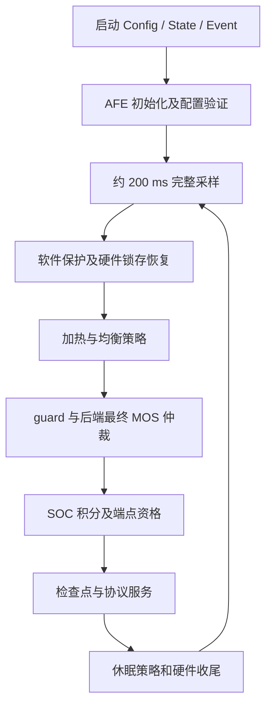

# 当前 BMS 逻辑审查与 D1245 参数适配方案

## 范围和结论

2026-11-11，审查源码基线为当时 HEAD `44dbecae`。
公共 core/app、D008 DVC 后端、参数/存储和通信/低功耗的主调用链为本次重点；
SH 后端核对采样、watchdog、保护恢复和 MOS 关键路径，未逐行审核整个 SH 驱动或 SDK/预编译库。
本报告不是“全仓无 bug”或量产签核结论。

规格来源为用户指定的《D1245 23串铁锂60A带均衡 规格书（修改）》旧版 Word，A0，5 页。
原文件 SHA-256：`905508230995d7b25dd98a9d59e34c0aef0168672482a5a0cfaeadb060e32d9e`。
只读提取表格，并回看参数表原排版第 2 页；原文件未修改。规格中的操作说明不作为本次操作授权。

当前 D008 **不能直接视为符合这份规格**：软件 50 A 放电过流会先于 60 A 连续工作要求动作；
电压、硬件过流、短路和均衡阈值也有差异。规格的持续充电 60 A 与充电过流 40±5 A 自相矛盾，
已向用户提问，尚不能据此确定充电保护参数。

本轮完成源码审查与参数映射，没有修改固件参数、生成 BIN、OTA 或操作设备。
按项目本机约定，没有执行 host 回归、目标编译/链接、静态分析工具或实板测试。
此前 `c8b64583` 的 BLE 修复和实板记录只覆盖当时固件，不是本规格的验收。

## 一次业务轮次与状态所有者



BLE 的 GATT 请求在 SDK 主循环回调中处理；UART 协议处理在采样之后。
图表示业务依赖，不表示所有协议请求都统一排在采样之后。

| 模块 | 当前所有权与异常路径 | 审查结论 |
|---|---|---|
| `app.c` | 到期标志、200 ms 调度、采样后功能/MOS/SOC、低频检查点 | 回调主要置位；长间断不补跑历史样本 |
| `bms_afe_guard.c` | 输出授权、持续 1 s 通信确认、配置禁止、watchdog 总线静默 | 必须保留测量失败与控制失败区别，不能合并成单个 ready 标志 |
| DVC 后端 | 测量发布、NTC、芯片锁存、PB1 负载移除、AUTO_DIODE | 关断后的零电流不作为负载移除；反向恢复与共同故障分别处理 |
| SH 后端 | 完整测量、WDT 重配、VADC/CADC 各组恢复、方向检测 | 不套用 DVC 寄存器与恢复时序；D011 fuse 安全电平保持 |
| 软件保护 | 私有三级活动位、触发/恢复计数；硬件位在报告边界合并 | First/Second 是告警，Third 才参与相应方向阻断 |
| `bms_features.c` | 加热阶段、逐串均衡资格/温度迟滞/实际位图 | 保留 OFF 未确认状态；请求位图不等于物理支路电流 |
| `bms_soc.c` | 唯一高精度电量、满空资格、OCV、显示节拍与循环 | 有效电流积分与电压校准资格分开；>400 ms 间断不补算 |
| Config/State/Event | 安全参数、估算状态、历史分别提交 | Config 或出厂事务未完成禁止输出；普通 State/Event 故障独立降级 |
| Modbus/BLE/UART/SIF | 边界校验、帧缓冲及引脚所有权 | SIF 主循环组包、IRQ 发波形；BLE 回压存在下述缺口 |
| `app_power.c` | 原因/计时、提交后保持、板级电源动作 | 普通 Suspend、ACC DeepSleep、PC4 断电三者不可互换 |

所核对的保护恢复、OTA 一次性标记、CRC/最后提交标记和无效串位 61001 约束应保留。
删除这些状态或门禁并不是等价简化。MCU reset 后 RAM 许可/故障丢失、ADC 活性独立检测已撤销等，
属于现有策略边界，本轮没有擅自改变。

## 已发现的问题和限制

### B1 持久事件日志可能漏掉短故障

优先级 P2，源码可确定，未运行反例。
`bms/app/app.c:103` 的任务超过 1000 ms 才从当前报告收集故障，随后调用
`bms_event_log_poll_1s()`；`bms/core/bms_event_log.c:224` 仅对这次快照做边沿检测。

例如某次秒任务后故障触发，随后在下一次秒任务前经反向电流恢复，两次快照都为 0，
该事件不会进入持久事件 RAM 环，后续等多久也无法补记。
`bms_sw_protection_record_fault_edges()` 维护的是另一套 RAM 故障编号历史，不能弥补该缺口。
这与“事件已经入 RAM、但 60 s checkpoint 前断电丢失”是两个不同问题。

建议在实际保护状态变化时仅追加/锁存小型 RAM 事件，Flash 仍由原检查点保存；
不在 ISR 或每次保护变化时立即擦写 Flash。验证须覆盖秒任务间的触发/恢复和多个事件。

### B2 BLE 通知队列满后丢弃剩余响应

优先级 P2，已确认失败分支；触发概率和终端表现未实测。
`bms/platform/telink/app_att.c:181` 把响应分成 20-byte Notify 连续入队；
一旦 `blc_gatt_pushHandleValueNotify()` 返回非成功就退出，没有保存待发送偏移。
调用方 `module_onReceiveData()` 又丢弃返回值，后续主循环没有续发入口。

因此“前几片已入队，后几片遇满”会留下半帧；客户端只能等超时/重试。
当前 TX FIFO 为 16 项，不能声称每个长响应必然失败：空队列时最大 Modbus 响应约 13 片可容纳，
但已有未发送数据、控制报文或连续请求时仍需处理回压。这不是本次已修复的 TC32 跳转表问题。

建议只维护一份待发送响应及偏移，在主循环有界续发；断连/超时清理，避免新请求覆盖旧响应。
不能通过在 GATT 回调中长期等待空位解决。验证包含队列中途满、断连和完整 CRC 重组。

### R1 循环计数对整数 SOC 边界往返敏感

`bms/core/bms_soc.c:434` 累计积分造成的整数 SOC 下降，而不是实际放电电荷。
在某整数边界附近少量放电跌一个百分点、再少量充电回到边界，反复往返会重复累计该百分点，
实际放电吞吐量可能远小于一个循环，进而影响经验 SOH 与有效容量。
这是 [SOC v3 说明](SOC_REFACTOR_20261020.md) 已明确保留的旧口径，不当作本轮新引入的缺陷。
如要改成吞吐量法，需要明确名义/有效容量基准及 State 持久化/迁移，不在参数适配时顺手更改。

### M1 旧 SOC 宏仍存在但已经不构造当前曲线

D008 等产品头中的 `BMS_SOC_OCV_LFP_POINTS`、`BMS_SOC_OCV_LFP_VERSION`、
`BMS_SOC_OCV_REST_PREPARE_S_DEFAULT` 等仍可见；当前默认模型由
`bms/core/bms_soc_profile.c:7` 的 v3 profile 构造，静置策略固定为 3600 s。
部分旧宏只剩定义和范围检查，编辑后不会产生注释暗示的算法效果。
配置窗口已有隐藏旧宏的处理；源码维护入口仍宜删除死宏或明确标为历史占位，并同步内容摘要规则。

### R2 软件延时是采样计数且触发采用漏积分

`bms_sw_filter_update()` 在未触发状态遇正常样本只递减计数，不是直接清零；
活动故障的恢复才要求连续合格。延时也按 200 ms 样本数向上换算。
这是当前明确实现，不能把“写入 50 ms”解释为具有 50 ms 软件保护能力，
也不能把间歇越限的漏积分触发描述为连续越限 1 s。规格中的快速过流/短路应由 AFE 承担。

## D1245 第 2 页参数与 D008 的差异

下表“目标”是适配方案，不是已修改值或实板达标结果。容量的 A/Ah、温度编码和串数不得混用。

| 项目 | 规格目标 | 当前 D008 23S LFP | 适配处理 |
|---|---|---|---|
| 化学体系/串数 | LFP / 23S | 已为 LFP / 23S | 保持当前 profile |
| 充电电压 | 82.8 V，即 23×3.6 V | BMS 不是稳压充电器 | 属于充电器设定，保护阈值单独配置 |
| 持续充/放电 | 60 A / 60 A | 软件充/放过流 Third=30/50 A，均为请求 100 ms | 当前配置不满足；阈值必须协调 |
| 单体过充 | 3650±25 mV，1±0.5 s | SW/HW 均 3750 mV，约 1 s | LFP SW/HW 动作值均改 3650，SW 一级/二级同时满足排序 |
| 过充恢复 | 3550±50 mV | SW/HW 3500 mV | 两条恢复路径统一至 3550 候选 |
| 单体过放 | 2700±80 mV，1±0.5 s | SW 2600 / HW 2500 mV | SW/HW 均改 2700 候选 |
| 过放恢复 | 2900±100 mV | SW 3100 / HW 2800 mV | SW/HW 均改 2900 候选 |
| 放电过流 1 | 120±10 A，500±150 ms | HW 80 A / 100 ms；SW Third 50 A / 100 ms | HW 120 A / 请求 500 ms，实际名义 496 ms；协调 SW Third，不保留 50 A 先动作 |
| 放电过流 2 | 300±30 A，50±15 ms | HW 100 A / 100 ms | HW 300 A / 请求 50 ms，实际名义 48 ms；软件 Second 不是第二级硬件保护 |
| 放电过流恢复 | 移除负载或充电激活 | PB1 有界确认，或新鲜反向充电 | 路径相符，仍须负载/反向实板验收 |
| 充电过流 | 40±5 A，1000±500 ms | SW 30 A / 100 ms；HW 60/80 A / 100 ms | 与持续充电 60 A 冲突，等待明确；不能保留旧 OCC2 更早动作 |
| 短路 | ≥600 A，200～500 µs | 名义 200 A / 请求 256 µs | 200 µΩ 下 120 mV 对应名义 600 A；256 µs 请求约 250 µs，硬件能力/公差待验证 |
| 均衡起始 | 3500±20 mV | 测试组 3300 mV，30/15 mV 压差 | 客户方案起始设 3500；关闭或调整测试组，压差规格未给出 |
| 均衡电流 | 36±10 mA | 由电阻/外置支路/电压/占空决定 | 无“设置 36 mA”的软件宏，需测实际支路及平均电流 |
| 充电高温/低温 | 55±5 ℃ / 0±5 ℃ | Third 50 ℃ / 0 ℃ | 动作编码 950 / 400；恢复温度及延时规格未给出 |
| 放电高温/低温 | 65±5 ℃ / −20±5 ℃ | Third 70 ℃ / −20 ℃ | 动作编码 1050 / 200；恢复温度及延时规格未给出 |
| 主动断线检测 | 有 | 已删除主动断线判定/锁存 | 缺失功能，不能用普通电压保护宣称已满足 |
| 静态自耗 | ≤100 µA | 常态 200 ms 采样、BLE、D008 PB4 无条件翻转 | 不是阈值参数；明确静态工况后测整板，不以 Suspend 代替达标 |
| 内阻/尺寸/NTC | ≤10 mΩ / 120×60×15 mm / 10K B3435 | D008 板级设计及多路 NTC | 属于硬件核对，不随保护参数自动匹配 |

### DVC 量化依据

已回看 DVC1124-2 RM V1.2 原 PDF 第 18～20、23～24 页，而非照搬 SH 手册：

- 分流器沿用 D008 的 200 µΩ；未取得另一装配实测值前不改变这一硬件输入。
- OC1 阈值步长 250 µV：120 A→24 mV→code 96；40 A→8 mV→code 32。
- OC1 延时 `(code+1)×8 ms`：500 ms 请求向下取整为 496 ms，1000 ms 可精确表示。
- OC2 阈值 `(code+1)×4 mV`：300 A→60 mV→code 14；50 ms 请求向下为 48 ms。
- SC 阈值 `code×10 mV`：名义 600 A→120 mV→code 12；延时 `code×7.81 µs`，256 µs 请求→code 32→249.92 µs。
- COV 阈值 `code×1 mV+500 mV`，3650 mV→3150；CUV 为 `code×1 mV`，2700 mV→2700；两者 1000 ms 有原生档位。

这些是标称编码计算，不包含分流器、比较器、测量和 MOS 关断时间误差。
尤其 ≥600 A 不是“写入名义 600 A 即保证实际最小触发电流≥600 A”；D008 功率器件/SOA/铜箔也不能由这份异板规格证明。

### 其它必须保留待定的内容

规格第 1/4 页的 AFE/BOM 是 SH3676014B/SH3676010B，不是 D008 的 DVC1124/TLSR8251。
第 3 页 B+ 还写“第 24 节”，与 23S 标题冲突；D008 仍按明确的 23S 目标，不据该条增至 24S。
规格没有电池容量，60 A 不是 60 Ah；当前 10.0 Ah 不能当作规格指定容量。
没有 MOS 温度恢复、均衡启停压差、温度滤波、加热、SOC 曲线和总压保护策略的完整要求。
当前总压 UVP Third 按每串 2800 mV 折算，各串电压接近一致时会早于单体 2700 mV 动作，适配时需协调。
规格只列一个 NTC；D008 仍按自己的电池双 NTC、MOS/加热 NTC 路由判定，不可因异板 BOM 而绕过必要温度故障。

## 不选配开关控制休眠和唤醒

**功能上已有可用宏，不必先新增一套开关状态机。** D008 的配置在
`bms/products/d008/bms_product.h:54`：

```c
#ifndef BMS_PRODUCT_SWITCH_SLEEP_ENABLE
#define BMS_PRODUCT_SWITCH_SLEEP_ENABLE 0
#endif
```

值 1：PA0/ACC 高电平请求深睡；保持 PC4 高，PA0 低电平 PAD 唤醒并重新初始化。
值 0：`app_acc_sleep_requested()` 恒为 0，不会进入 ACC 深睡，也就不会到达它的 PA0 唤醒布防。
正常启动 `app.c:423` 已明确关闭 PA0 PAD 唤醒。下表以正常 MCU 复位后的执行路径为准。

| 行为 | 宏设为 0 后 |
|---|---|
| PA0 高导致 ACC 休眠 | 禁用 |
| ACC 深睡中的 PA0 低唤醒 | 不进入该状态，不布防该唤醒 |
| PA0 的 GPIO 输入初始化 | 仍存在；该宏目前明确不裁剪电气输入 |
| 普通 Suspend 与 200 ms 定时采样 | 保持 |
| BLE/通信正常工作与原普通唤醒 | 保持 |
| 低压、过放、AFE 异常保护性休眠 | 保持 |
| `0x1102=0x000A` 命令关机 | 保持 |
| PB1 负载移除和过流恢复 | 保持；PB1 不是 ACC 开关 |

`BMS_PRODUCT_SWITCH_ENABLE` 在 D008 已为 0，但它不是 D008 ACC 路径的总开关，不能只改这个宏。
若产品要求“PA0 数字输入也关闭、ACC 代码完全不参与编译”，可在 D008 路径使用同一选择
显式裁剪 ACC helper/状态及输入初始化，并保持禁用 PAD；须更新当前宏的语义说明并核对引脚电气状态。
当前仅需关闭开关休眠/唤醒时，设置已有宏为 0 即可达到功能目标。

D008 的低压/过放/AFE 异常和命令路径会拉低 PC4，切断 MCU 供电，与 ACC 保持供电深睡不同。
关掉 ACC 不会自动增加新的复电源；MCU 已断电时 BLE/普通 GPIO 软件均无法唤醒。
不装开关的硬件版本必须核对充电/外部供电如何恢复 MCU 电源，不能仅靠宏承诺可唤醒。

## 建议实施顺序

1. 明确充电 40 A/60 A 冲突、容量及是否必须恢复主动断线检测；约定 ≤100 µA 的测量工况。
2. 先限定 D008 23S 客户方案，填软件/AFE/业务参数对照表，避免扩散其它产品/装配默认。
   软件一级/二级排序、总压保护、OCC2 和测试均衡分支须一起核对。
3. 开关选配只改 D008 的已有宏；需要裁剪电气输入时再做局部条件编译。
4. 事件采集与 BLE 分片回压分别做独立修复；旧 SOC 宏做单独清理，不与保护参数混合大重构。
5. 参数完整确定后通过正式源码保存入口生成新 OTA ID；沿用用户已明确的出厂重置策略时必须生成新包 ID。
   不能修改参数后复用上一次出厂包 ID。当前报告不会创建或发送更新包。
6. 获准执行验证后，公共改动覆盖四产品 sources/link/resources 和相关 host；D008 再做保护阈值/延时、
   反向电流、负载移除、均衡温升、无开关复电、整板自耗及 OTA 参数实读。静态审查不替代这些结果。
