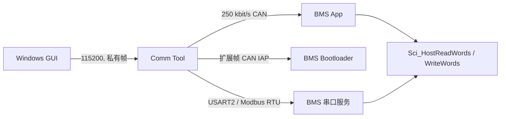

# CAN 上位机完整技术说明

文档状态：CURRENT / 维护入口

源码验证：FULL

最后更新时间：2026-10-12

适用程序：`tools/comm_tool_upgrade_ui.py`、`tools/comm_tool_upgrade_ui_i18n.py`、`dist/BMS_CommTool_Upgrade_UI*.exe`

## 1. 产品定位与边界

当前 Windows 上位机用于 BMS 实时监控、寄存器读写、参数配置、历史记录、老化入口以及 App 升级。同一套源码生成客户/内部和中文/英文四个固定版本；版本矩阵、访问规则及发布流程见 [CAN 上位机版本与语言交付指南](CAN_UPPER_UI_EDITION_AND_LANGUAGE_GUIDE.md)。其中客户中文版始终保留原固定交付名 `dist/BMS_CommTool_Upgrade_UI.exe`。

界面虽然提供两种通信方式，但**两种方式当前都需要 Comm Tool 硬件**：

| 界面模式 | PC 到 Comm Tool | Comm Tool 到 BMS | 实际协议 |
|---|---|---|---|
| `comm tool/CAN桥` | USB 虚拟串口，115200 8N1 | CAN，默认 250 kbit/s | PC 私有协议 → CAN App/IAP |
| `BMS直连串口` | USB 虚拟串口，115200 8N1 | USART2，默认 19200 8N1 | 先配置 Comm Tool，再透传 Modbus RTU |

因此“BMS直连串口”是**经 Comm Tool 的串口桥接模式**，不是上位机原生支持任意 USB-RS485/USB-UART。没有 Comm Tool 时，当前 GUI 不能直接控制通用 USB-CAN，替代方法见 [无 Comm Tool 的 BMS 通信接入指南](BMS_WITHOUT_COMM_TOOL_GUIDE.md)。

## 2. 软件组成

| 文件/目录 | 职责 |
|---|---|
| `tools/comm_tool_upgrade_ui.py` | Tkinter GUI、协议客户端、轮询、日志和升级主逻辑 |
| `tools/comm_tool_upgrade_ui_i18n.py` | 运行时中英文界面翻译，不改变协议字段和数值 |
| `tools/can_bms_host.py` | 基于 python-can 的通用 CAN 命令行工具 |
| `tools/start_can_bms_host.ps1` | 通用 CAN 工具 PowerShell 入口 |
| `COMM_TOOL/` | Comm Tool 固件，负责 PC 串口、CAN 与 BMS UART 桥接 |
| `dist/BMS_CommTool_Upgrade_UI*.exe` | 客户/内部、中/英文四个固定名称可执行文件 |

GUI 主要依赖 Python 标准库、Tkinter 和 `pyserial`。打包使用 PyInstaller；四个程序只通过 EXE 名称选择版本和语言，业务源码、CAN/Modbus 协议实现保持共用。

## 3. 总体架构



同一套寄存器读写最终进入 BMS 的 `Sci_HostReadWords()` / `Sci_HostWriteWords()`，因此 CAN 桥与 Modbus 桥在地址、权限和数据语义上应保持一致。

## 4. 启动、连接与配置

### 4.1 PC 串口

- 波特率固定 115200，8N1。
- 用户选择 Comm Tool 对应的 COM 口。
- 界面打开客户端后执行设备信息和链路检查。
- 多个后台任务共用 `serial_lock`，避免串口交叉请求。

### 4.2 CAN 桥模式

- Comm Tool 默认 CAN 波特率 250 kbit/s。
- 默认 BMS App 节点地址由工具配置，典型值为 0 或 1，必须与现场设备一致。
- Comm Tool 将 PC 的读写请求转换为 BMS 标准帧 App 协议，将升级请求转换为扩展帧 CAN IAP。

### 4.3 串口桥模式

切换到“BMS直连串口”时，上位机先以 115200 打开 Comm Tool，发送 `SET_BMS_UART` 配置其 USART2，然后用相同 PC COM 口创建 Modbus 客户端。BMS 侧默认参数为 19200 8N1、从站地址 1；界面还提供 9600～115200 等可选波特率。

### 4.4 一线通监控

当前源码使用 A1.3.3 标准字段，上位机同时识别已交付 Comm Tool 的快照 version=1 和 App 0.2.6 的 version=2，无需为恢复当前监控重刷 Comm Tool；GUI已删除 `Telink (legacy)`，CLI已删除 `--profile`。客户/内部、中/英文四版共用入口，客户版无需维护解锁。选择Comm Tool COM口，点击“实时监控”连接区的“一线通监控”并开始。该窗口独占串口，需先停止其它监控和任务。

连接盒OW/P-按原理图接BMS COM/P-，VCC按板级要求供电；PC通过CH340/USART1 `115200 8N1`。窗口只读，不拼接Modbus寄存器、不写参数、不提供升级或应答业务。停止/正常关闭发送停止命令；异常退出由10s租约释放上拉。租约到期后GUI/CLI清理显示，留出2s关闭间隔后重新启用，等待BMS重新接入。

BMS线版本采用0x13（主1/次3），与PC快照version=2独立。电流 `raw*0.1-500 A`（正放电、负充电），温度 `raw-40 ℃`；SOC、电压、电流、温度、循环次数及单体位置按范围检查，异常值显示 `--`。单体无效值为0xFFFF。显示厂家代码、型号、材料名称、额定电压/容量、故障码及名称、工作状态及原值、请求应答设备、充电状态及原值。没有真实配置的厂家/型号/额定电压仍为无效；文档没有静置码，本地BMS发送FF未知值，不显示为回馈。

用户明确不实现加密、充电策略和互认；界面明确提示未实现。BMS请求充电参数/回馈限流/充电状态为无效，key=0表示未实现加密，需解码的BMS状态显示 `--`，原始字节仍可查看。不得将非零key或原始状态解释为认证通过；不得称完整支持A1.3.3智能充电。8bit/0.1A充电电流字段的表示上限为25.4A，不能按1A精度错误扩展；文档“范围0～250”与位宽/精度存在歧义，当前不据此生成充电请求。

任一有效帧年龄不超过5s才判定链路在线。`0x3A` 超过5s过期，`0x3B/3C` 超过75s过期；离线时隐藏测量和编码，不能把旧长周期报文显示为在线；最新3A电压无效或已过期时立即隐藏旧单体，不等待下次60s单体帧；接收端同时作废失效前的旧单体，恢复后须等新单体帧。`0x01` 仅显示本次会话的静态接入信息，不随75s消失，也不展示其中历史电压/电流；离线时明确标注“接入信息（离线）”。停止/接收器关闭/串口异常清空显示。

v2 Comm Tool首次收到有效帧、失联超过5s后恢复或公有帧在其它ID后重新出现时，清缓存并递增session；连续三帧公有帧不切会话，坏校验不改变身份。上位机五次查询必须version/session/enable一致，跨会话整组重读。v1的头部末两字节为保留零值，没有会话或自动清缓存能力，界面显示 `snapshot=v1, session=--`；开始监控命令会清缓存，换电池或BMS重启后必须停止再开始。v2无新公有帧且间隔不超过5s的替换也没有可靠身份边界，换电池同样应停止再开始。原始窗口显示报文、实际年龄、序号、快照版本和session，统计有效帧、SUM错误、时序错误及溢出。

BMS接入顺序为三帧01、一帧3B、三帧3C；后续3B约60s更新，3C紧随一帧，其间发送3A。接入沿用OW上拉检测，尚无独立DETD输入。0x3C取已提交 `Config.user.serial[32]`，不读暂存区，不回退为0xC002的共享编译默认SN。正常为最多32字节可打印ASCII，不带NUL；空/全空格/非法SN或读取失败发送单字节FF，显示 `--`。SN跨设备唯一性由配置来源保证。

2026-10-13原一线通实板通信已由用户确认，用户也已更新D008固件。此前重建EXE后严格要求快照v2，导致现有Comm Tool返回v1时出现 `OWC snapshot version mismatch`；这属于PC快照交付回归，与BMS一线通版本独立。现上位机识别两种快照布局；专项检查 `py -3.9 tools/check_comm_tool_owc_snapshot.py` 回放v1/v2真实布局、五ID查询，并确认坏SUM、非法版本/保留字段、无效v2会话及过期数据仍受拒绝或隐藏。此检查不连接串口、不编译固件、不生成BIN；EXE打包及启动检查不代表实板通信复验。

CLI：`py -3.9 tools/comm_tool_host.py owc-monitor --port COMx`，Ctrl+C停止。完整扩展格式见 [Comm Tool串口协议](../protocol/COMM_TOOL_SERIAL_PROTOCOL.md)。获准运行验证时，可执行 `tools/check_comm_tool_owc.py` 和GUI `--self-test`；本轮仅更新断言，未运行，不把已有实板结果当成新改动验收。

## 5. 界面功能

客户版启动后仅显示“实时监控”和“存储信息”；底部“维护解锁”输入默认密码 `hs456` 后，才显示实时数据、参数设置、系统状态和其它功能。内部版启动后直接显示全部六页。界面可重新锁定；关闭程序后不保存解锁状态。该机制只限制可见入口，不是加密或设备侧鉴权。

### 5.1 实时监控

- 优先读取 `0xD000` 连续 88 words。
- 失败时回退到 `0xD000` 63 words，再按需要读取 `0xD115` 4 words。
- 可配置轮询周期 1～60 s。
- 展示单体电压、总压、温度、电流、SOC、SOH、容量、循环、故障和均衡等。
- 单体原始值 0 或 61001 视为无效。
- 通信失败或停止监控时清理过期显示，避免把旧数据误当实时值。

关键换算：

| 字段 | 寄存器偏移 | 显示换算 |
|---|---:|---|
| 单体电压 | 0..31 | mV |
| 总电压 | 37 | raw / 100 V |
| 10 路温度 | 38..47 | raw / 10 - 40 ℃ |
| 充/放电电流 | 50..51 | raw / 10 A |
| SOC/SOH | 52..53 | % |
| 容量 | 54..56 | raw × 10 mAh |
| 循环次数 | 57 | 次 |
| 故障字 | 58..60 | 位图解析 |
| 均衡状态 | 61..62 | 位图解析 |

### 5.2 产品信息

实时监控底部边栏显示：

- BMS 序列号；
- 硬件版本；
- 软件版本。

读取来源固定为 `0xC002` 的 48 个寄存器。每个 word 按大端字节展开，共 96 字节，依次为 32 字节序列号、32 字节硬件版本、32 字节软件版本 ASCII。成功结果缓存 30 s，以减少轮询负担。

### 5.3 实时数据记录

- 支持按 2～3600 s 间隔写出 CSV。
- CSV 使用 UTF-8 BOM，方便中文 Windows Excel 直接打开。
- 启停记录与实时监控共用串口互斥；高负载时监控线程会短暂退避。

### 5.4 存储信息与历史记录

- 历史记录入口为 `0xC008`，总计 100 words。
- 为降低超时风险，当前按 5 次、每次 20 words 读取。
- 单段最多重试 3 次，重试间隔约 0.3 s。
- 清除/复位入口写 `0x1007=1`，执行前必须由用户明确确认其业务影响。

### 5.5 参数设置

参数页采用“整块读取 → 修改内存副本 → 整块写入 → 回读确认”的方式，避免局部字段与设备状态不一致。当前页面分为保护参数、均衡/限流、休眠、SOC/系统四个页签；电压、电流、温度、MOS 和 AFE 短路全部集中在同一个“保护参数”界面，内部按左右分区和矩阵行对齐。

顶部提供“读取当前页、全部读取、写入修改(N)、放弃修改”。修改项以浅黄色高亮；放弃修改会恢复最近一次读取或回写确认值，而不是只清除状态标记。详细布局和后续 AI 修改要求见 [CAN 上位机参数设置页设计与 AI 修改指南](../design/CAN_UPPER_UI_PARAMETER_PAGE_DESIGN.md)。

| 参数组 | 地址范围 | 长度 |
|---|---|---:|
| SH309 AFE 参数 | `0x2400..0x2417` | 24 words |
| MOS 温度参数 | `0x2132..0x2136` | 5 words |
| 其他参数 | `0x2300..0x231F` | 32 words |

参数含义、合法范围和写权限必须以 BMS 寄存器映射及当前源码为准。上位机不应替代固件端的边界校验。

### 5.6 系统状态与高级读写

- 系统状态可从扩展实时区读取，失败时使用 `0xD115` 4 words 回退。
- 高级读写支持一次 1～120 words。
- 写操作可能改变保护阈值、校准值或持久化数据，只允许对已确认的地址执行。

### 5.7 其他功能与老化

界面入口为 `其它功能 -> 常用功能 -> 读取老化时间`，设计上解析 `0x13 BMS_AGING_STATUS` 及 `0x14F80208` 广播。

但当前 BMS 实现存在两项硬限制：

- CAN App 的 `0x07～0x0A` 老化命令被 `#if 0` 禁用，会返回 BAD_CMD；
- `0x14F80208` 的进度和剩余时间字段固定为 100，不是实时数据。

因此该功能当前不能作为量产老化判定依据。恢复功能时应先修改并验证 BMS 协议实现，再更新 GUI。

## 6. PC ↔ Comm Tool 私有串口协议

帧格式：

```text
55 AA VERSION FLAGS SEQ_L SEQ_H CMD STATUS LEN_L LEN_H PAYLOAD... CRC_L CRC_H
```

- VERSION 当前为 1。
- `SEQ`、`LEN` 为小端。
- CRC16 采用低字节在前。
- 单帧最大长度 512 字节。

主要命令：

| CMD | 功能 |
|---:|---|
| `0x01` | GET_INFO |
| `0x02` | SET_CAN |
| `0x10` | BMS_READ |
| `0x11` | BMS_WRITE |
| `0x12..0x14` | 老化相关转发入口 |
| `0x15` | SET_BMS_UART |
| `0x20..0x23` | 固件缓存写入、校验与管理 |
| `0x30..0x33` | 升级控制 |
| `0x40` | RAW CAN 预留，当前未分发 |
| `0x41` | DIAG |
| `0x42` | DEBUG |

Comm Tool 当前固件版本为 0.2.4，PC 串口默认 115200，BMS UART 默认 19200，CAN 默认 250 kbit/s。其 CAN 控制器支持 125/250/500 kbit/s，并开启自动重发；这与 BMS App 的无自动重发配置不同。

## 7. 网关时序与容错

- Comm Tool 的 CAN 请求重试间隔约 100 ms。
- 状态/普通读取 ACK 超时约 1000 ms。
- ENTER_IAP 超时约 5000 ms。
- 老化命令超时约 2000 ms。
- READ_BLOCK 完整数据超时约 6000 ms。
- READ_BLOCK 失败时，仅在 `count<=4` 的情况下回退为逐个 READ_REG。
- 多 word 写入由 Comm Tool 拆成多个单 word `WRITE_PREP`/`WRITE_COMMIT`。
- GUI 后台事件约每 80 ms 处理；串口忙时监控轮询额外退避约 500 ms。

## 8. 固件升级

### 8.1 安全边界

- IAP/Bootloader 地址：`0x08000000`。
- App 地址：`0x08004800`。
- BMS App scatter：`103 + 309/Project/Users/Objects/FD_Release.sct`。
- Bootloader 实际 App 上限：`0x0801F800`（不含）。
- 严禁将 App bin 裸写到 `0x08000000`。

GUI 通用检查路径目前允许镜像到 `0x08020000`，比 Bootloader 实际上限多 0x800 字节；串口直连路径使用 `0x0801F800`。在此差异修复前，应一律使用更严格的 `0x0801F800`。

### 8.2 GUI 升级流程

1. 停止实时监控和 CSV 记录，释放串口独占。
2. 读取并校验 bin；检查大小、CRC16/CRC32、初始 MSP 和 Reset_Handler。
3. 将镜像分片写入 Comm Tool 缓存，每片最多 496 字节。
4. 要求 BMS App 进入 IAP。
5. 由 Comm Tool 执行 HELLO、START、DATA、COMMIT、END。
6. 等待升级结果和 BMS 重新启动。
7. 重连后读取版本和关键实时数据确认。

升级过程中不得并行执行监控、日志、参数读写或其他维护命令。

## 9. 线程和错误处理

- 所有耗时串口操作在后台 worker 中执行，避免阻塞 Tk 主线程。
- 共享串口通过互斥锁串行访问。
- UI 更新通过事件队列回到主线程。
- 停止事件用于终止监控和记录；升级前主动停止这些 worker。
- 通信超时、CRC、设备状态和参数错误应分开提示，避免统一显示为“连接失败”。
- 设备离线后必须清空实时值或显式显示陈旧状态，不能继续展示最后一次数据。

## 10. 构建与交付

修改上位机后必须立即重新构建全部四个版本：

```text
dist/BMS_CommTool_Upgrade_UI.exe
dist/BMS_CommTool_Upgrade_UI_EN.exe
dist/BMS_CommTool_Upgrade_UI_Internal.exe
dist/BMS_CommTool_Upgrade_UI_Internal_EN.exe
```

统一构建命令为 `powershell -ExecutionPolicy Bypass -File tools\build_comm_tool_upgrade_ui_exe.ps1 -Variant All`。构建前运行中英文源码自检，构建后逐个启动 EXE 做最小界面验收。正式交付建议包含：

- 与客户身份和语言匹配的固定名称 EXE；
- 匹配版本的 Comm Tool 固件；
- USB 驱动说明；
- [BMS CAN 通信协议完整说明](../protocol/can_protocol.md)；
- 连接线定义和终端电阻说明；
- 已验证的 BMS App/IAP 版本组合。

## 11. 已知限制

| 限制 | 影响 |
|---|---|
| GUI 不原生支持 PCAN/Kvaser/slcan | 无 Comm Tool 时不能直接用该 GUI |
| “BMS直连串口”仍依赖 Comm Tool | 名称容易让客户误解 |
| BMS CAN 老化命令未编译 | 老化按钮在 CAN 模式不可用 |
| 老化广播是固定占位值 | 不能显示真实剩余时间 |
| GUI 与 Bootloader 镜像上限不完全一致 | 极限大小镜像存在升级失败风险 |
| CAN IAP 源码不在主仓库 | 版本配套和复现存在管理风险 |
| 通用 CAN CLI 缺少寄存器块读入口 | 无 Comm Tool 的完整监控需要扩展脚本 |

## 12. 最小回归清单

1. 两种模式都能连接、断开和重连，不残留串口占用。
2. 实时监控连续运行，断线后数据清空，恢复后重新刷新。
3. `0xC002` 三个产品信息字段显示正确。
4. CSV 可被 Excel 正确打开，时间戳和单位正确。
5. 参数整块读取、修改、写入和回读一致。
6. 历史记录 5 段读取完整，失败重试不会重复或错位。
7. 升级前自动停止并发任务，拒绝非法地址/大小的镜像。
8. 升级完成后能读回软件版本和实时数据。
9. 对当前禁用的老化命令给出明确“不支持”，不得显示伪成功。
10. 客户版锁定、正确密码解锁、错误密码拒绝和重新锁定行为正确。
11. 四个 EXE 的版本和语言与文件名匹配，英文界面没有残留的中文操作项。
